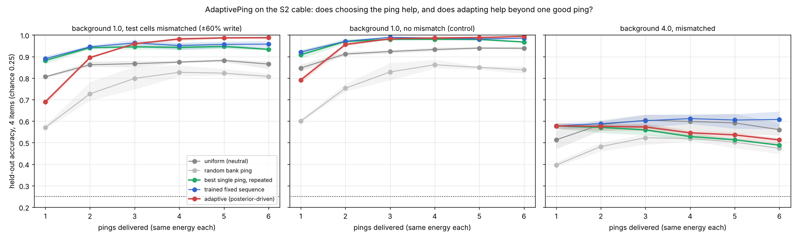

# SilentPing

**Can a neutral ping read an item out of state that is invisible at rest?**

This is an in-silico version of Wolff et al. (2017), where a remembered item that could not be decoded from ongoing EEG became decodable from the response to a task-irrelevant "ping". It also tests the mechanism Stokes (2015) proposed for it: activity-silent state that changes the operator a later input passes through.

The harness joins two lines from the atlas. From the ECG, V24 and AlgoSchalgo line it takes the probe side. From the NotSoSimpleNeuron, OperatorTime and EATON line it takes the resident state. It tests the joined object with a known-answer design.

Run it with `python silent_ping.py`, which writes `results.json` in about 3 minutes on 1 CPU. Then run `python make_figure.py` to make `silent_ping.png`.

## Substrates

- **S1, STF.** Tsodyks-Markram facilitating/depressing synapses (U = 0.2, τF = 1.5 s, τD = 0.2 s) project from 80 afferents to 400 Poisson output neurons. Each of 4 items drives its own afferent set for 250 ms. The ping is one synchronous spike on every afferent, identical on every trial. This is the mainstream mechanism (Mongillo, Barak & Tsodyks 2008) and serves as calibration.
- **S2, CABLE.** One passive 24-compartment cable with the soma at compartment 0. A slow, synapse-specific resident gain tag `s` (τ = 3000 steps) is written only where input arrives while the membrane is past threshold, in an NMDA-like coincidence. The tag emits nothing and only multiplies later input: `v' = A v + (1 + g s)·input`. Items are 4 landing sites at increasing distance. The ping is a uniform input to all compartments. Only the soma voltage is read.

## Conditions

Every condition shares the same stimulus and delay history.

| condition | question | expected if the claim holds |
|---|---|---|
| delay | decode from output during the late delay | chance (the state is silent) |
| rest | decode from the readout window, no ping | chance |
| rest_power / delay_power | second-order attacker: binned variance | chance, if truly silent |
| ping | same window, neutral ping | high |
| reset | resident state reset to baseline just before the ping | chance (the ping alone carries nothing) |
| swap_donor | resident state transplanted from a different-label trial; ping-trained decoder | reports the **donor's** label |

Chance is 0.25 (4 items). The permutation-null 95th percentile is about 0.29–0.30 (40 label shuffles, 600 trials).

## Results (frozen run, `results.json`)

| | delay | rest | rest_power | delay_power | **ping** | reset | **swap→donor** |
|---|---|---|---|---|---|---|---|
| S1 STF (bg 0.5 Hz, 1 s) | 0.333 | 0.265 | 0.233 | 0.243 | **0.805** | 0.270 | **0.733** |
| S2 cable (bg 1.0, 1500 steps) | 0.222 | 0.250 | 0.348 | 0.357 | **0.835** | 0.260 | **0.840** |

**Passed.** In both substrates the Wolff pattern appears: rest decoding is at chance, ping decoding is high, and reset is back at chance. The transplant receipt is the strongest line. Moving only the resident state makes the ping report the donor's item (0.73 and 0.84), while agreement with the trial's own stimulus drops to 0.10 and 0.08. So the ping reads the state, not the trial's history.

**Where the silent tag sits can be read from one soma trace (S2).** Ping echoes peak later the farther the tag is: roughly 8, 43, 67 and 86 steps for compartments 3, 7, 12 and 18. The full waveform decodes location at 0.84. Amplitude alone decodes it at 0.64. Under ±60% write-strength jitter, norm-normalized shape (0.74 → 0.71) holds up better than amplitude (0.64 → 0.58). Part of the location is carried by *when* the echo arrives, which is the "length is a temporal coordinate" idea showing up in a readout.

## What this does not show (the ledger)

1. **Silence is gain × drive, not absence.** Every background input passes through the same state-gated operator, so background activity is a stream of tiny, random, incoherent pings.
   - S1 uses positive background. The delay window already leaks slightly at 0.5 Hz (0.333, just above the null) and reaches 0.375 at 1 Hz. By 2 Hz, listening (0.35) roughly matches pinging (0.38).
   - S2 uses balanced, zero-mean background. It is silent to a linear decoder but **not** to the variance attacker (0.35 at rest, 0.36 in the delay window).
   - A ping is the coherent, synchronized version of what background does incoherently. Its advantage exists only while drive is low.
2. **The ping reads u·x, not u.** At 250 ms, S1 ping decoding (0.78) is *lower* than at 500 ms (0.93) because depression has not recovered yet and partly cancels facilitation.
3. **Short delays are not silent.** In S2 at 250 steps, rest decoding is 0.88 because the stimulus-driven voltage has not decayed. The "silent" claim starts once the fast activity has died, which is after about 1000 steps here.
4. **The effect has a lifetime set by the state's own time constant.** It falls to chance by about 3 s in S1 and decays over about 9000 steps in S2. Background facilitation in S1 also shrinks the contrast (u baseline rises).
5. **This is a known-answer reproduction, not a discovery.** Both mechanisms were built so that the state changes gain, so ping decoding is designed in. What the harness adds is the **controls**: reset, transplant, the variance attacker, and the drive sweep. These are what separate "the ping read the state" from "the ping carried information itself" and from "the state was never really silent."

## Next discriminators, if the line continues

- Apply the transplant and variance attackers to a *learned* system (a small RNN trained on delayed match-to-sample with synaptic plasticity), where nobody chose the coefficients.
- ~~Test whether an impulse-optimized ping beats the neutral one.~~ Done below (AdaptivePing): yes, at low drive; adaptation adds a smaller further gain under model mismatch; at high drive nothing helps much and repeated pings in one place corrupt the memory.
- Make the decoder update its templates as the state changes across pings, and make the adaptive rule pick its first ping by tested accuracy rather than template distance. Both failures are visible below.
- Carry the policy comparison to the learned RNN above, where the templates cannot be built from a known simulator.

## AdaptivePing: does choosing the ping help? (Oct 2026)

`python adaptive_ping.py` (~11 min) writes `adaptive_results.json`; `python make_adaptive_figure.py` draws `adaptive_ping.png`.

**Setup.** The S2 cable exactly as above. A ping is now any non-negative spatial input profile with the **same L2 energy** as the neutral uniform ping. The bank holds the uniform ping, two ramps, and Gaussian bumps of width 1.5 and 4 centred on every compartment (51 pings). Up to six pings go to the same trial in sequence, so the state carries over, and a strong ping can write the tag as well as read it. Every policy uses the **same decoder**: per-ping Gaussian templates from 400 training trials, log-likelihoods summed across pings. Only the choice of ping differs. Test trials are new (400 per seed, 3 seeds), and in the main condition their write strength varies ±60% while the templates assume it is fixed. That mismatch keeps the selector from winning just by knowing the simulator.

Policies: **uniform** (the README's ping, repeated), **random** (a random bank ping each time), **fixed_best** (the bank ping with the best one-ping accuracy on training trials, repeated), **schedule** (a fixed sequence chosen greedily on training trials, run sequentially), and **adaptive** (after each ping, pick the bank ping that maximises the posterior-weighted template separation Σ πᵢπⱼ Dᵢⱼ).

Held-out accuracy, background 1.0, mismatched test cells (mean of 3 seeds, chance 0.25):

| pings | 1 | 2 | 3 | 4 | 6 |
|---|---:|---:|---:|---:|---:|
| uniform | 0.81 | 0.86 | 0.87 | 0.87 | 0.87 |
| random | 0.57 | 0.73 | 0.80 | 0.83 | 0.81 |
| best single ping, repeated | 0.88 | 0.94 | 0.95 | 0.94 | 0.93 |
| trained fixed sequence | **0.89** | **0.95** | 0.96 | 0.95 | 0.96 |
| adaptive | 0.69 | 0.90 | 0.96 | **0.98** | **0.99** |

**1. A shaped ping beats the neutral one.** One broad bump centred near compartment 8 reads the silent tag better than the uniform ping at the same energy: 0.88 against 0.81 after one ping, and a plateau of about 0.94 against 0.87. Repeating the neutral ping never reaches 0.90 here. Most of the available gain comes from finding one good ping.

**2. Adapting adds a further, smaller gain, and only after a bad start.** From the fourth ping on, adaptive's worst seed (0.97–0.98) beats every fixed policy's best seed (at most 0.97). The mean error falls from about 4–5% for the trained fixed sequence to 1–2%, a cut of about two thirds. Its first ping is poor (0.69) because it picks by template separation, and the separation it prefers does not survive the write-strength mismatch. Without mismatch (middle panel) a trained fixed sequence matches adaptive (0.99 at three pings), so adaptation pays mainly when the model is wrong.

**3. At high background (4.0), choosing pings barely helps, and repeating one focal ping hurts.** All policies stay between 0.5 and 0.6. The best single ping and adaptive both hammer a bump near the soma, and their accuracy falls with each ping (0.58 → 0.49 and 0.58 → 0.51). The fraction of the tag sitting at the true site falls with it (0.35 → 0.30): pinging the same place under strong drive writes a false tag there. The trained sequence, which saw its own pings' after-effects during training, moves around and holds 0.61. Reading a silent memory can overwrite it.

**4. Pinging also wrote the true tag back.** At background 1.0, adaptive pings land on the suspected site, and the tag mass left at the true site after six pings is 0.69 of its starting value. Under the other policies it is 0.42–0.47, close to the tag's own decay over that time (0.40). Part of adaptive's late advantage is that its reads refresh the memory they are reading, and the decoder benefits from a stronger signal. This is a simulator mechanism, not a claim about brains.

**Ledger.** Templates come from first-ping states, so later pings are decoded with slightly stale templates; a step-aware decoder might change the high-drive picture. The bank is 51 hand-built shapes, not an optimised continuous profile. One substrate, one readout, 4 items. Training accuracies of the chosen pings are in-sample and optimistic (best single ping: 0.95 training vs 0.88 held out at background 1.0, 0.85 vs 0.58 at 4.0). The matched control and the tag-integrity readout were added after a first quick run showed accuracy falling with repeated pings; the policies, bank, decoder and main condition were fixed before it.
